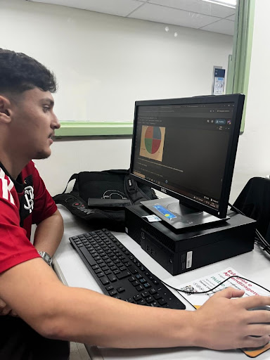

# Análise de dados históricos da Segunda Guerra Mundial

<p align="center">
  
  
  
  
</p>

<p align="center">
  <strong>Projeto acadêmico de Ciência de Dados e História Digital</strong><br />
  Desenvolvimento técnico individual por Joseph Alexsander Krescher De Souza
</p>

<p align="center">
  <a href="https://colab.research.google.com/github/Alex5762/meu-tcc/blob/main/notebooks/projeto_analise_tcc.ipynb">
    
  </a>
</p>

## Sobre o projeto

Este projeto analisa registros históricos de missões de bombardeio aéreo realizadas principalmente pelas forças Aliadas durante a Segunda Guerra Mundial (1939–1945).

A análise utiliza o conjunto de dados **THOR (Theater History of Operations Reports)**, que contém **178.281 registros e 62 colunas**. O objetivo é explorar os dados, identificar padrões descritivos e aplicar técnicas de análise e modelagem com Python.

**O desenvolvimento técnico deste projeto foi realizado integralmente por mim**, incluindo a estruturação do notebook, preparação dos dados, análises, visualizações, experimentos de Machine Learning e documentação.

## Prévia de uma visualização

<p align="center">
  
</p>

## Etapas desenvolvidas

1. **ETL e preparação dos dados**
   - Carregamento do conjunto THOR em formato CSV.
   - Padronização e tradução de variáveis para português.
   - Organização dos campos e tratamento de datas.

2. **Análise exploratória**
   - Inspeção da estrutura, dimensões e valores do conjunto de dados.
   - Estatísticas descritivas e agrupamentos por país, ano e tipo de alvo.
   - Consultas SQL em DataFrames utilizando `pandasql`.

3. **Tratamento de valores extremos**
   - Identificação de outliers na variável de aeronaves por missão.
   - Aplicação do método do Intervalo Interquartil (IQR) e criação de uma base filtrada para análises específicas.

4. **Visualização de dados**
   - Histogramas e gráficos de densidade.
   - Gráficos de barras, setores e evolução temporal.
   - Nuvem de palavras com os nomes dos alvos.

5. **Mineração de dados**
   - Aplicação do algoritmo **Apriori** para explorar regras de associação entre países de origem e tipos de alvo.

6. **Experimento de Machine Learning**
   - Implementação de **Regressão Logística** com Scikit-learn.
   - Classificação da origem das missões considerando latitude, longitude e quantidade de aeronaves.
   - Separação dos dados em conjuntos de treino e teste (80%/20%) e avaliação com métricas de classificação.

O experimento de Regressão Logística tem finalidade acadêmica e exploratória. Ele não representa um sistema preditivo em produção nem deve ser interpretado isoladamente como conclusão histórica.

## Tecnologias e bibliotecas

| Tecnologia | Utilização |
|---|---|
| Python | Linguagem utilizada no projeto |
| Jupyter Notebook | Desenvolvimento e documentação da análise |
| Pandas e NumPy | Manipulação e preparação dos dados |
| Matplotlib e Seaborn | Visualizações estáticas |
| Plotly | Gráficos interativos |
| WordCloud | Nuvem de palavras |
| pandasql | Consultas SQL sobre DataFrames |
| MLxtend | Mineração de regras de associação com Apriori |
| Scikit-learn | Regressão Logística e avaliação do modelo |

## Estrutura do repositório

- `notebooks/projeto_analise_tcc.ipynb`: notebook principal, com o pipeline, as análises, os gráficos e os experimentos.
- `notebooks/roteiro_extensao.ipynb`: documentação contextual e roteiro do projeto.
- `notebooks/roteiro_extensao_para_pdf.ipynb`: versão simplificada do roteiro.
- `dados/datamil-world-war-ii-thor-data/data/`: arquivos CSV utilizados como fonte de dados.
- `docs/evidencias/`: registros visuais do desenvolvimento e da execução.

## Como executar

### Opção 1 — Google Colab

1. Abra o notebook pelo botão **Open in Colab** no início deste README.
2. Execute as células em sequência, usando **Ambiente de execução → Executar tudo**.

### Opção 2 — Ambiente local

1. Clone o repositório:

   ```bash
   git clone https://github.com/Alex5762/meu-tcc.git
   cd meu-tcc
   ```

2. Crie e ative um ambiente virtual:

   **Windows (PowerShell):**

   ```powershell
   python -m venv .venv
   .\.venv\Scripts\Activate.ps1
   ```

   **Linux ou macOS:**

   ```bash
   python -m venv .venv
   source .venv/bin/activate
   ```

3. Instale as dependências:

   ```bash
   python -m pip install --upgrade pip
   python -m pip install pandas numpy matplotlib seaborn plotly wordcloud mlxtend scikit-learn pandasql jupyter
   ```

4. Inicie o Jupyter:

   ```bash
   jupyter notebook
   ```

5. Abra `notebooks/projeto_analise_tcc.ipynb` e execute as células em ordem.

> **Observação:** o notebook principal carrega o CSV por uma URL pública do próprio repositório. Por isso, a execução precisa de conexão com a internet. Caso o projeto seja executado a partir de um fork, confira e ajuste a URL de origem dos dados na célula de carregamento.

## Fonte dos dados e limitações

- **Dataset:** [THOR — Theater History of Operations Reports](https://data.world/datamil/world-war-ii-thor-data).
- Os registros representam principalmente operações aéreas Aliadas. Portanto, não descrevem integralmente todas as operações ou perspectivas dos países envolvidos na guerra.
- A base contém campos ausentes e limitações próprias de registros históricos. Os resultados devem ser interpretados considerando essas restrições.

## Uso de ferramentas de IA

Durante o desenvolvimento, utilizei ferramentas de IA como apoio para compreender trechos de código, investigar erros e revisar a redação. A definição do escopo, a implementação, as decisões técnicas e a revisão do resultado ficaram sob minha responsabilidade.

---

**Desenvolvido individualmente por Joseph Alexsander Krescher De Souza.**
